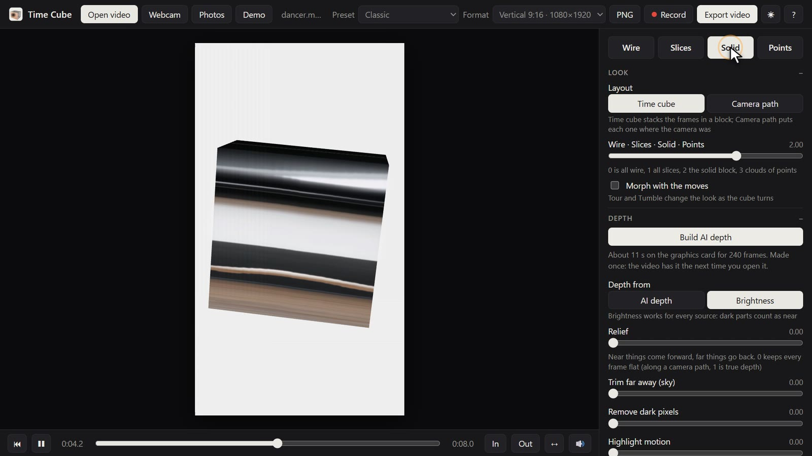
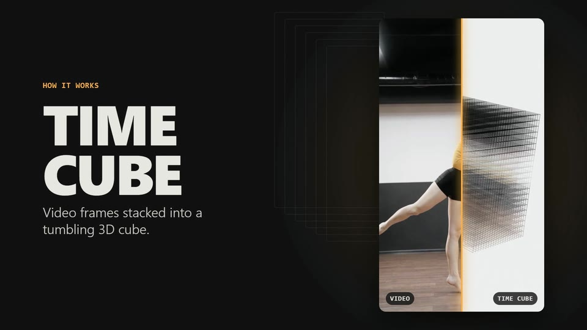
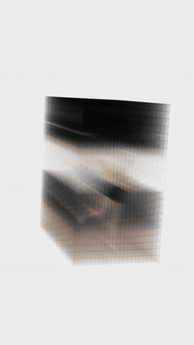
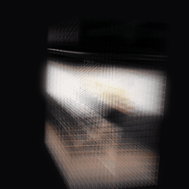
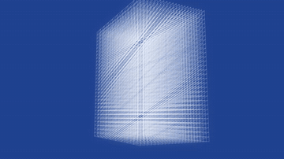
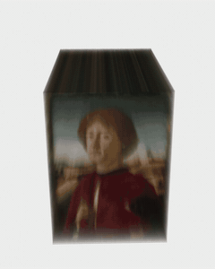
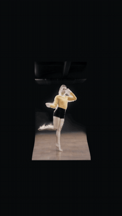
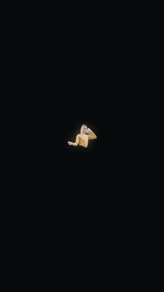

# Time Cube

Video frames stacked into a tumbling 3D cube: the front face is now, the back face is a moment ago, and turned
sideways the cube shows time as streaks. It morphs between a wireframe stack, see-through slices, a solid block and
clouds of points. With an NVIDIA graphics card it can also give a video **AI depth** (every frame becomes a relief of
the scene), lay the frames along the **camera path** measured from the video, **track** one thing through the video,
and say **what the AI sees** in it.

**Everything runs on your computer. No account, no API key, nothing is uploaded.** The AI models download once, for
free, the first time you use them (the caption model is a file you download yourself, see below).

Inspired by a TouchDesigner piece in a reel by [nayana](https://www.instagram.com/reel/DeJe5aAh0fQ/). Time Cube is an
independent project and shares no code with it.



<!-- videos:start -->
## See it in action

<p align="center"><a href="docs/videos/tutorial.mp4"></a><br><b>▶ <a href="docs/videos/tutorial.mp4">How it works</a></b> (0:58, with captions)</p>

**Made with Time Cube, from a free Pexels clip and public-domain portraits (The Met)**

<table><tr>
<td width="33%" align="center"><a href="docs/videos/examples/dancer-classic.mp4"></a><br><a href="docs/videos/examples/dancer-classic.mp4">Classic, Vertical 9:16</a></td>
<td width="33%" align="center"><a href="docs/videos/examples/dancer-night-lines-square.mp4"></a><br><a href="docs/videos/examples/dancer-night-lines-square.mp4">Night lines, Square 1:1</a></td>
<td width="33%" align="center"><a href="docs/videos/examples/dancer-blueprint-wide.mp4"></a><br><a href="docs/videos/examples/dancer-blueprint-wide.mp4">Blueprint, Wide 16:9</a></td>
</tr><tr>
<td width="33%" align="center"><a href="docs/videos/examples/portraits-glass-stack.mp4"></a><br><a href="docs/videos/examples/portraits-glass-stack.mp4">Glass stack, photos, 4:5</a></td>
<td width="33%" align="center"><a href="docs/videos/examples/dancer-depth-points.mp4"></a><br><a href="docs/videos/examples/dancer-depth-points.mp4">Depth points (AI depth)</a></td>
<td width="33%" align="center"><a href="docs/videos/examples/dancer-follow-one.mp4"></a><br><a href="docs/videos/examples/dancer-follow-one.mp4">Follow one (Track)</a></td>
</tr></table>

Click any picture to play the video. Example sources: "A Woman Dancing Gracefully" by [Pavel Danilyuk](https://www.pexels.com/video/a-woman-dancing-gracefully-6939968/) (Pexels licence); portraits by [Biagio d'Antonio](https://www.metmuseum.org/art/collection/search/435664), [Cosmè Tura](https://www.metmuseum.org/art/collection/search/437851), [Jacometto](https://www.metmuseum.org/art/collection/search/436769), [Adriaen Hanneman](https://www.metmuseum.org/art/collection/search/436630), [Velázquez](https://www.metmuseum.org/art/collection/search/437874) and [Giovanni di Francesco](https://www.metmuseum.org/art/collection/search/437859), The Met (CC0).
<!-- videos:end -->

## Install

You need:
- Windows 10 or 11 (it is built and tested on Windows 11)
- [Python](https://www.python.org/downloads/) 3.11 or newer
- [ffmpeg](https://ffmpeg.org/download.html) on your PATH (ffmpeg and ffprobe), for videos and exports
- Google Chrome or Microsoft Edge: the app opens in its own window. The cube is drawn with WebGL2.

The cube, the looks, the moves and every export need nothing more. Start it with:

```
python launch.pyw
```

Optional: `powershell -ExecutionPolicy Bypass -File make_shortcut.ps1` puts a **Time Cube** shortcut on your Desktop.

### The AI parts (optional)
**AI depth**, **Camera path from the video** and **Track** need an NVIDIA graphics card. Install PyTorch first, from
[pytorch.org](https://pytorch.org/get-started/locally/) (the CUDA build), then:

```
python -m pip install -r requirements.txt
```

- The first **Build AI depth** downloads [Depth Anything large](https://huggingface.co/LiheYoung/depth-anything-large-hf)
  (about 1.3 GB) into your Hugging Face cache.
- The first **Find** in Track downloads [CLIPSeg](https://huggingface.co/CIDAS/clipseg-rd64-refined) and
  [SAM](https://huggingface.co/facebook/sam-vit-base) (about 1 GB together). On a slow connection the first try can
  time out while they download; try again and it carries on.

**What the AI sees** uses Qwen3-VL 4B. It needs about 6 GB of free graphics memory and two things:
1. The model file `qwen3vl_4b_fp8_scaled.safetensors` (4.9 GB), the single-file version ComfyUI uses. Download it from
   [Comfy-Org/Qwen3-VL](https://huggingface.co/Comfy-Org/Qwen3-VL/resolve/main/text_encoders/qwen3vl_4b_fp8_scaled.safetensors)
   on Hugging Face and put it in this app's `models\` folder. If you already have it (for example in ComfyUI's
   `models\text_encoders` folder), set the `TIME_CUBE_QWEN_MODEL` environment variable to the file, or to the folder
   that holds it, instead of copying it.
2. A small Python environment for the captions, because Qwen3-VL needs transformers 4.57:
   `powershell -ExecutionPolicy Bypass -File make_caption_env.ps1` (a one-off, about 130 MB). It is made in
   `%LOCALAPPDATA%\TimeCube\caption-env`, sees your Python's packages and adds only that transformers, so your other
   apps are not touched. `-Python <path to python.exe>` picks another Python to build it on.

Without these, the rest of the app works as usual and the section says what is missing.

## How to use it
Press **?** in the app for the shortcuts. **☀ / ☾** in the top bar (or **T**) switches the window between dark and
light, and the choice is remembered.

- **Sources** (top bar). You can also drop a file anywhere on the window.
  - **Open video**: any video Chrome can play (MP4/H.264 is safest). `samples\dancer.mp4` is a clip to try.
  - **Webcam**: live, mirrored by default.
  - **Photos**: several pictures played as stop-motion. **Photo hold** sets how long each one stays.
  - **Demo**: a built-in animated scene, so there is always something to see.
- **The cube** keeps the last **Frames in the cube** frames (8–180). A new frame enters every **Frame step**
  frames. **Cube depth** stretches time front to back, and **Newest frame at the back** turns it around.
  - **Shape of time**: **Cube**, **Stack** (the older frames lean up behind now, so the past peeks out above it) or
    **Echo** (the older frames shrink toward the middle, like a tunnel).
  - **Spiral** turns each older frame a little more around the time axis; the value is the turn of the oldest.
  - **Fade older frames** keeps the newest frame whole and thins out the older ones into a trail (Wire, Slices,
    Points).
- **Depth** (the second section of the panel):
  - **Build AI depth** gives every frame of the open video its depth, made on the NVIDIA card with Depth Anything.
    It takes about 20 ms a frame plus a few seconds to load the model, so a 5 s clip is ready in about 10 s. The
    panel and the top of the picture show the progress; **Stop** ends it.
  - It is made once per video: the same file opened again has its depth at once (it is found by the file's
    contents, not its name). Depth unused for 3 days is cleaned up.
  - **Depth from**: **AI depth**, or **Brightness** (dark parts count as near). Brightness works for every source,
    including the webcam, photos and the demo; AI depth is for videos.
  - **Relief**: how far near things come toward the front and far things go back. 0 keeps every frame flat.
  - **Trim far away (sky)** and **Remove dark pixels** clear those parts away. **Highlight motion** fades what
    stays the same from one frame to the next and keeps what moves.
  - When a build finishes, the cube switches to AI depth with some relief, so you see it straight away.
- **Track** (for videos):
  - Pause where the thing is in clear view. **Find**: type it ("the man", "a blue car", "cowboy hat") and it is
    marked in the paused frame (CLIPSeg finds where the words fit, SAM cuts it out precisely). **What's in this
    moment** lists everyday things it sees there as chips; a chip finds that. **Click it in the picture** opens the
    picker: click an outline to pick it, or anything else to cut it out.
  - **Follow it** follows the picked outline through every frame (about a tenth of a second a frame, so about 15 s
    for 5 s of video, with progress and Stop). If it leaves the shot or something covers it, it is let go there;
    the section says in how many frames it was seen. The same video opened again has its track; **Clear the
    track** removes it. One object at a time.
  - **Isolate tracked** keeps only the object. **Dim the rest** fades everything else into the background colour.
    **Track line** draws a glowing line through the object's centre in every frame of the cube (at its AI depth),
    in its **Line colour**. They work in both layouts and every look, and in exports.
  - Typed words find clear subjects best (people, cars, animals, hats); clicking is the precise way.
- **What the AI sees** (for videos):
  - The file's details: name, picture size and codec, length, frame rate, file size, sound.
  - **Describe the video**: 3 to 8 moments spread over it, each in one sentence with its time (click the time to go
    there), and **Place, a guess**: where it might have been filmed. About 1 s a moment, plus ~20 s to load the
    model the first time. Kept with the video, like its depth.
  - **Ask about this moment**: pause, type a question, press Ask (about a second once the model is loaded).
  - **Caption on the picture**: the caption of the moment, in a dark box at the bottom; it goes into PNGs,
    recordings and exports too.
  - With less than about 6 GB of free graphics memory (another AI program running), the section says so instead of
    crawling.
- **Layout** (top of Look): **Time cube** (everything above) or **Camera path**:
  - Every frame goes where its camera was, and its points go out to their distance (the AI depth). The view sits at
    the newest camera, so the front view is the video itself; Sway, or drag, to see the 3D.
  - **Path from**: **From video** is measured from the video (it needs its AI depth); **Orbit** (round the middle of
    the scene), **Walk** (straight ahead) and **Turn** (on the spot) are made up, for clips whose camera held still.
    **Speed along the path** sets how fast the made-up ones go.
  - The **map** shows the path from above: the stretch in the cube now, and where the camera is. Under it: how long
    the measuring took and how many steps were solved.
  - **Camera lens**: a video doesn't store its lens; 65° across the long side is assumed (phones: about 65–75°).
    Change it and the path is measured again for that lens (about a second for 5 s of video).
  - **Show the path** draws the line the camera took and an orange outline around now.
  - Points work best. Slices are drawn as sheets (cut where the depth jumps, so they don't stretch between near and
    far things), Wire as a grid per frame, Solid as sheets. **Relief 1** is the true depth, 0 puts every frame flat
    on the path. The view turns around the subject's distance (the middle of the picture), or the middle of the
    frames with **Turn around: Cube centre**. Shape of time, Spiral and Cube depth are for the time cube.
- **Looks**: **Wire · Slices · Solid · Points**, the four buttons, or keys 1 to 4. The slider blends between them.
  - **Wire**: each plane is a grid of triangles drawn in the colours of the frames it passes through.
    - **Planes through Columns** cuts vertical planes through time, giving long time-lines. **Frames** gives one
      plane per moment, and **Rows** cuts horizontal planes.
    - Other settings: Grid, Cell length through time, Planes, Line width, Opacity, Line contrast, Ink and Ink
      colour, Triangles, and Depth relief (dark parts bulge).
  - **Slices**: see-through frames, drawn back to front. **Clear the brights** makes light areas transparent.
  - **Solid**: the block. Its front is the current frame, and its sides are the edge pixels of every frame (a
    slit-scan). **Side shading** darkens the faces turned away from you.
  - **Points**: each frame as a cloud of round points in its colours, lifted by the relief. **Frames shown**,
    **Point density** (points across the picture), **Point size** (1 = touching) and **Opacity**.
  - Slices and Wire take the relief too; Solid takes the trims.
- **Moves**:
  - **Tour** plays a 30-second choreography as a loop: flat front view, the wire stack swinging edge-on, a dense
    dark pass, the solid block tumbling upside down, back to the wire, and home to the front.
  - **Tumble** is an endless slow tumble that swings between Solid and Wire every 16 s.
  - **Sway** swings slowly left and right (38°) and a little up and down around the front view, so the relief keeps
    showing.
  - **Spin** turns at your own speeds. **Still** stays put.
  - **Turn around**: **Cube centre**, or **Newest frame**, which keeps now in the middle of the picture while the
    past swings behind it.
  - With **Morph with the moves** on, Tour and Tumble also change the look. Moving the look yourself switches it
    off.
  - **Mouse**: drag to turn the cube, Shift-drag (or right-drag) to pan, scroll to zoom, double-click to reset.
  - Also: Speed, Zoom and Lens.
- **Finish**: Background colour, **Transparent background**, Glow (a soft halo around the bright parts), Glow
  size, Glow from, and Grain.
  - With **Transparent background** on, the preview shows a checkerboard where the picture will be see-through.
    Exports and PNG stills then keep only the cube and its glow; the glow fades out into the transparency, so it
    still looks right over any footage.
- **Source** tone: Brightness, Contrast, Saturation, Soften and Mirror. These reach the whole history at once.
- **Presets**:
  - **Classic**: the default.
  - **Ink sketch**: frame planes in dark ink.
  - **Glass stack**: ghost slices.
  - **Slit-scan block**: a long solid block.
  - **Night lines**: dark background with glowing lines.
  - **Blueprint**: white lines on blue.
  - **Long exposure**: 180 frames, every 2nd one.
  - Made for AI depth (they also work with brightness): **Depth points** (the newest frame as a 3D point cloud with
    a fading trail, swaying), **Depth sheets** (see-through relief sheets) and **Motion trails** (only what moves).
  - Shapes of time: **Time tunnel** (Echo with a spiral) and **Stack of moments** (Stack, a few solid frames).
  - Along the camera path: **Camera path** (points along the measured path, swaying), **Walk through time** (sheets
    on a made-up walk) and **Orbit ring** (sheets round a circle).
  - With a followed object: **Follow one** (only the object, as points, with its track line) and **Follow along
    the path** (the camera path with the rest dimmed).
  - A preset doesn't change **Depth from** or **Camera lens**: they belong to the video, not the look.
  - **Reset to preset** undoes your changes. Double-click a slider's name to reset just that slider.
- **Under the picture**:
  - Play/pause and back to the start.
  - The scrub bar, for videos and photos.
  - **In** / **Out**: the part of the video an export uses.
  - **↔**: back to the whole clip.
  - Sound on/off.
- **Format**: Vertical 1080×1920, Portrait 1080×1350, Square 1080×1080, Wide 1920×1080 or 4K 3840×2160. The preview
  shows that frame.
- **Export video** (**E**):
  - It renders frame by frame at full size: 30 or 60 fps, quality High or Best.
  - **Background: Colour** gives an H.264 MP4. **Transparent** gives a video with an alpha channel, in one of two
    types:
    - **ProRes 4444 .mov** (the default): for Premiere, After Effects, Resolve and Final Cut. Large files; Best is
      ProRes 4444 XQ. The sound is uncompressed PCM.
    - **VP9 alpha .webm**: small files that stay transparent in Chrome, Edge and Firefox. Not for Final Cut.
    - Transparent frames go to the server uncompressed, so these exports are slower (about 6–10 frames a second at
      1080×1920).
  - For a video it uses the In–Out part and keeps its sound. For photos and the demo you set the length.
  - With AI depth, every exported frame gets its own depth, exactly as in the preview.
  - The server reads the video with ffmpeg at exactly the export frame rate, so the export matches the preview
    with no dropped frames.
  - It encodes on the NVIDIA GPU (NVENC) when it can, and with libx264 otherwise.
- **PNG** (**P**) saves the current frame at full size, transparent when Transparent background is on.
- **Record** (**R**) records what you see, live, including your mouse moves. It works for every source and is the
  way to capture the webcam. It is saved as an MP4 at full size (up to 1920 px on the long side) and a steady frame
  rate, always on the background colour (live recordings can't be transparent). If the MP4 can't be made, the
  recording is kept as a WebM, so it is never lost.
- **Where files go**:
  - Every file is saved to `Videos\Time Cube` in your user folder. Set the `TIME_CUBE_OUT` environment variable to
    use another folder.
  - Existing files are never overwritten.
  - **Show in folder** in the message opens the file in Explorer.

## What's where
- `launch.pyw`: the launcher. It starts the server hidden and opens the Chrome or Edge app window. The server quits
  a little after the window closes.
- `server.py`: the local server (Python standard library + ffmpeg) on `127.0.0.1:47963` (`TIME_CUBE_PORT` changes
  it).
  - It keeps a copy of an opened video in `%LOCALAPPDATA%\TimeCube\media`. Copies are removed after 3 days.
  - It runs `depth.py`, one video at a time, and keeps the result in `%LOCALAPPDATA%\TimeCube\depth`, named by
    the video's contents (SHA-1). `/api/depth/start`, `status`, `cancel`, `data`, and `path?fov=` (the camera
    path for a lens, measured then if it isn't yet).
  - It runs `track.py` (one command at a time; Stop ends the process) and keeps the followed object next to the
    depth. `/api/track/find`, `here`, `cut`, `follow`, `status`, `cancel`, `clear`, `data` and `info`.
  - It runs `caption.py` with the caption environment's Python and keeps the captions next to the depth.
    `/api/caption/describe`, `status`, `ask` and `clear`.
  - **Decode sessions** read the video as raw frames for an export.
  - **Encode sessions** turn rendered frames into H.264 with the video's sound, or into ProRes 4444 / VP9 alpha
    when the background is transparent.
  - It also saves PNGs and live recordings.
  - Frame uploads and reads carry a frame number, so a dropped connection is retried safely.
  - It opts itself and its ffmpeg processes out of Windows power throttling.
- `depth.py`: AI depth for one video, in a process of its own (so its graphics memory is freed when it is done).
  - ffmpeg reads the video at the depth frame rate (the video's own, up to 30 fps; lower for videos over 90 s);
    Depth Anything runs on the GPU in batches of 8; each frame is stretched from far (0) to near (255) between its
    2 % and 98 % depths, smoothed over ±2 s so the scene keeps its depth when someone walks up to the camera.
  - It writes one byte a pixel, 320 px on the long side, then measures the camera path (lens 65°), and reports
    progress as JSON lines. It stops by itself if the server goes away.
- `path.py`: the camera path of a video, from its frames and AI depth.
  - Corners are followed through the frames (OpenCV optical flow, checked backwards). Once they have moved 12 px (or
    after 10 frames), the camera's move since that keyframe is solved from the keyframe's 3D points (PnP with
    RANSAC, so people walking through don't count). Moves are chained, the frames between are filled in (positions
    interpolated, turns slerped) and the path is smoothed a little.
  - Distances use the depth's own unit: nearness n becomes 1 / (0.08 + 0.92 n); the window places points by the
    same rule, so the frames line up with their path.
  - Checked against a rendered scene with a known path (`tests/test_path.py`): off by about 0.2 % of the path's
    length with the true depth, and about 4.4 % through Depth Anything.
- `track.py`: finding and following an object, kept running by the server while Track is used (closed after 5
  idle minutes, so its graphics memory is freed).
  - Find: CLIPSeg (CIDAS/clipseg-rd64-refined) marks where the words fit; for the strongest places SAM
    (facebook/sam-vit-base, half precision on the GPU) cuts out what is there, keeping the one of its three
    cut-outs (a part ... the whole) most like the marked place. What's here: CLIPSeg asked about ~40 everyday
    words. Click: SAM from the point.
  - Follow: starts from exactly the picked outline; the points inside it are followed to the next frame (optical
    flow), which moves its box; SAM cuts it out again there, keeping the cut-out most like the last frame's. It
    is let go when none is like it, SAM is unsure, or it shrinks to a sliver of its size in the last second.
  - Writes a mask per frame (the depth's size) and every frame's centre, box and median AI depth.
  - Checked with a rendered ball (`tests/test_track.py`): the masks cover 97 % of the true ball, centres off by
    0.1 px, and it is let go when the ball leaves the picture.
- `caption.py`: what the AI sees, kept running by the server while the section is used (closed when idle).
  - It loads Qwen3-VL 4B straight from its single file: the language model's big weights stay fp8 on the GPU and
    are unpacked layer by layer as they are used (about 5.5 GB in all). The settings are the ones in ComfyUI's
    `qwen3vl.py`.
  - It looks for the file where `TIME_CUBE_QWEN_MODEL` points (the file, or a folder holding it), then in
    `models\`.
- `models\qwen-tokenizer\`: the Qwen tokenizer files the captions use (by the Qwen team, Apache 2.0, see the
  `LICENSE` in that folder). `models\` is also where `qwen3vl_4b_fp8_scaled.safetensors` can go.
- `make_caption_env.ps1`: makes the captions' Python environment (a one-off).
- `static/`: the window.
  - `index.html` and `app.css` lay out the page.
  - `js/main.js`: the controls, sources, frame clock, mouse and keys.
  - `js/renderer.js`: the WebGL2 renderer.
    - The last N frames live in one 3D texture used as a ring buffer; each texel's alpha holds its AI depth.
    - Wire is instanced, anti-aliased screen-space lines. Their grid points sample the volume in the vertex shader.
    - Slices are textured planes, sorted back to front.
    - Solid is the box's faces sampling the volume where they are (the sides are strips, so they bend with the
      shape of time).
    - Points are drawn as GL points sized to the grid spacing on screen.
    - Every look places its points through the same `shape()`, so Stack, Echo and Spiral reach all of them.
    - Camera path: each layer keeps its camera (a 4 × N float texture). Points go out from it to their distance
      (`alongPath()`); the view is the newest camera turned around a pivot. A line program draws the path.
    - Track: a second volume holds the object's mask in every frame (written with the frame, two outputs), and
      each layer keeps the object's centre for the track line.
    - The scene is drawn into a transparent multisampled buffer. A glow pass and a compose pass lay it over the
      background, over a checkerboard (transparency preview), or turn it into straight alpha for transparent
      exports.
    - The caption on the picture is a text texture added in the last pass, so the preview, PNGs, recordings and
      exports show the same thing.
  - `js/paths.js`: the made-up paths, following a measured path between its frames, and the map.
  - `js/track.js`: the Track picker (the paused frame with the outlines, clicks).
  - `js/camera.js`: the Tour keys (a looping C1 spline), Tumble, Sway and Spin, and the weights of the four looks.
  - `js/presets.js`: every setting, the presets and the formats. The side panel is generated from this list.
  - `js/sources.js`: video, webcam, photos and the demo scene.
  - `js/export.js`: the frame-by-frame MP4 export.
  - `js/mat.js`: small 4×4 matrix helpers.
- `make_shortcut.ps1` creates the Desktop shortcut. `make_icon.py` draws `icon.png` / `icon.ico`.
- `samples/`: a free dancer clip to try (and the end-to-end test's real footage), with its credit in
  `samples/CREDITS.md`.
- `tests/`: see below.

Your data: `%LOCALAPPDATA%\TimeCube\` (`TIME_CUBE_DATA` changes it) holds the video copies, depth, tracks, captions,
logs and the caption environment. The AI depth and Track models are in your Hugging Face cache.

## Tests
```
python tests/test_server.py         # 12 server tests: upload, decode, encode, alpha, retries, keep-alive, saves
python tests/test_depth.py          # 7 AI depth tests (needs the NVIDIA card and the Depth Anything model)
python tests/test_path.py           # 4 camera path tests (the Depth Anything one needs the NVIDIA card)
python tests/test_track.py          # 5 tracking tests (needs the NVIDIA card and the SAM + CLIPSeg models)
python tests/test_caption.py        # 4 caption tests (3 need the caption environment, the Qwen3-VL file and the card)
node tests/js/camera.test.mjs       # the Tour keys, the seamless loop, the look weights, Sway
node tests/js/shape.test.mjs        # Stack, Echo and Spiral
python tests/test_e2e.py            # everything in Chrome; --clip <video> uses your own footage
```
The GPU tests are skipped when the card or a model is missing (they never download a model). The end-to-end run
needs Google Chrome and Playwright (`python -m pip install playwright numpy pillow`), and the whole AI setup above: it
runs the unit tests first, then drives the real app through every feature, AI depth, the camera path, tracking and
what the AI sees included. Its real footage is 4 s of `samples\dancer.mp4` (Track looks for a "person"), or your
own clip with `--clip`. It writes `report.html` to `Time Cube - Tests` in your temp folder (`--review <folder>` picks
another folder): every check, screenshots of every look, preset and source, the Tour moves, and the exported files.

## Credits
- Inspiration: a TouchDesigner piece in a reel by [nayana](https://www.instagram.com/reel/DeJe5aAh0fQ/).
- [Depth Anything](https://huggingface.co/LiheYoung/depth-anything-large-hf) (Apache 2.0) for AI depth.
- [CLIPSeg](https://huggingface.co/CIDAS/clipseg-rd64-refined) and [SAM](https://huggingface.co/facebook/sam-vit-base)
  (both Apache 2.0) for Track.
- [Qwen3-VL 4B](https://huggingface.co/Qwen/Qwen3-VL-4B-Instruct) by the Qwen team (Apache 2.0) for What the AI
  sees, in the single-file version from [Comfy-Org/Qwen3-VL](https://huggingface.co/Comfy-Org/Qwen3-VL); its tokenizer
  is in `models\qwen-tokenizer` (Apache 2.0).
- Sample clip: "A Woman Dancing Gracefully" by
  [Pavel Danilyuk](https://www.pexels.com/video/a-woman-dancing-gracefully-6939968/)
  ([Pexels licence](https://www.pexels.com/license/)).
- Examples and tutorial video in `docs/`: made with Time Cube from the sample clip above (with a generated
  tone as its sound) and, for the stop-motion example, six public-domain portraits from The Met (CC0) by
  [Biagio d'Antonio](https://www.metmuseum.org/art/collection/search/435664), [Cosmè Tura](https://www.metmuseum.org/art/collection/search/437851), [Jacometto](https://www.metmuseum.org/art/collection/search/436769), [Adriaen Hanneman](https://www.metmuseum.org/art/collection/search/436630), [Velázquez](https://www.metmuseum.org/art/collection/search/437874) and [Giovanni di Francesco](https://www.metmuseum.org/art/collection/search/437859).
- [transformers](https://github.com/huggingface/transformers), [PyTorch](https://pytorch.org/),
  [OpenCV](https://opencv.org/) and [ffmpeg](https://ffmpeg.org/).

## Licence

Time Cube's own code is MIT, see [LICENSE](LICENSE). The models and the tokenizer files keep their own licences.
